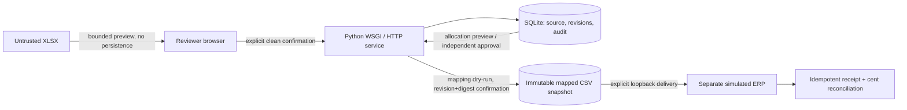
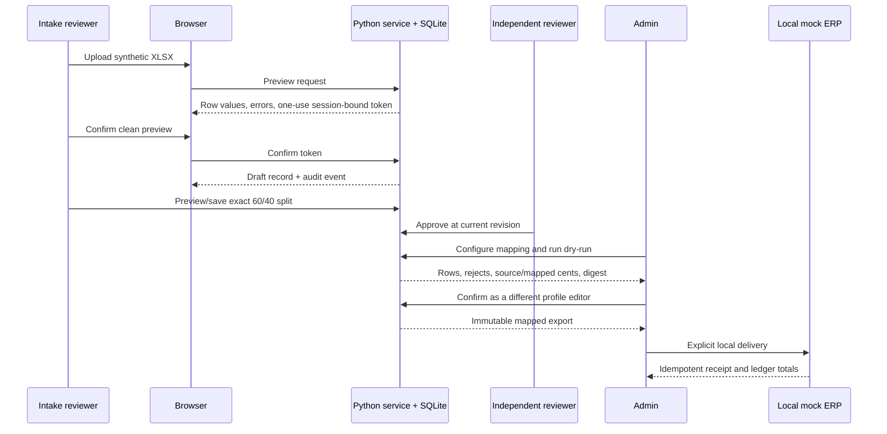

# LedgerBridge 2.0 campaign candidate

This document describes the LedgerBridge 2.0 **local-first portfolio release candidate**, including its acceptance evidence and operational limits. Releasing the code on GitHub does not constitute public deployment, permission to process real customer data, or a live accounting integration. OCR/AI extraction and M7 remain excluded.

## Quickstart

Requirements: Python 3.11+, Node/npm for browser tests, and the pinned dependencies in `requirements-prod.txt` plus `package.json`.

```sh
python -m pip install -r requirements-prod.txt
npm install --no-package-lock --ignore-scripts
python -m unittest discover -s tests -v
python -m pilot.run
python -m pilot.campaign_demo
python scripts/release.py --check
```

`pilot.campaign_demo` uses a temporary SQLite source/target database, generates a workbook in memory, and deletes both databases at exit. It has no network dependency. The 11-case original pilot remains separate and must continue to report 8 exports totaling `$638.00`.

## Architecture and boundaries



The Python service owns parsing, validation, authorization, revision checks, transactions, and export snapshots. Vanilla JavaScript renders the review workflow; browser state is never authoritative. SQLite migrations are versioned and supported older document databases are backed up before upgrade. The mock ERP is a separate local SQLite store. It is not a real connector.



## Two-minute manual walkthrough

Use a fresh temporary database and invented credentials. In one terminal:

```sh
python -m ledgerbridge.admin --db /tmp/ledgerbridge-v2-demo.sqlite3 add-user intake --role reviewer
python -m ledgerbridge.admin --db /tmp/ledgerbridge-v2-demo.sqlite3 add-user approver --role reviewer
python -m ledgerbridge.admin --db /tmp/ledgerbridge-v2-demo.sqlite3 add-user mapper --role admin
python -m ledgerbridge.admin --db /tmp/ledgerbridge-v2-demo.sqlite3 add-user exporter --role admin
python -m ledgerbridge.server --local-auth --db /tmp/ledgerbridge-v2-demo.sqlite3
```

In a second terminal run `python -m ledgerbridge.mock_erp --db /tmp/ledgerbridge-v2-target.sqlite3`; open `http://127.0.0.1:8765`.

1. Sign in as `intake`; upload a synthetic `.xlsx` with `vendor,date,total,account_code`, inspect the financial values and any row errors, then confirm. No record exists before that confirmation.
2. Open its draft, add `Fund A / 60%` and `Fund B / 40%`, inspect computed cents and zero difference, preview again, then explicitly confirm saving.
3. Sign out and sign in as `approver`. Inspect the source/history and approve. The allocator cannot approve their own changes.
4. Sign in as `mapper`, open Export History, map `5100 = 6100`, enable allocation expansion, save, and run the dry-run. Confirm that two rows reconcile to the source cents and that nothing has been exported yet.
5. Sign in as `exporter`, confirm the mapped export, then send it to the local demo ERP. Verify the receipt and retry; the retry reuses the receipt without duplicating ledger rows.

Use the automated workbook generator and Playwright flow for deterministic browser data: `python tests/create_synthetic_xlsx.py` and `npm run test:browser` with the authenticated app and mock ERP running. Do not copy the credentials above into a deployed environment.

Negative credits are opt-in through the administrator's business-rules screen. Existing databases without the setting retain the prior default of rejecting credits; zero-value records remain invalid. The Playwright and Python suites cover a synthetic enabled-credit split and its signed-cent mock receipt.

## Reproducible synthetic benchmark

Run `python -m pilot.campaign_demo`. The harness reports a measured wall-clock duration for one local execution, synthetic source/allocation/export row counts, integer-cent totals at each stage, balance difference, idempotent retry result, distinct synthetic actor count, and the audit events corresponding to workflow decisions. These actors and events are scripted; they are not observed human labor actions. The benchmark does **not** estimate human time, labor savings, operational throughput, extraction accuracy, or real customer outcomes. Timings vary by machine; the assertion that matters is a zero-cent reconciliation difference.

Example observed run: one XLSX row, two allocation rows, one independent approval, two mapped/ERP rows, 10,001 cents at source/allocation/export/ERP, zero-cent difference, retry replayed. The elapsed time is printed at each run rather than treated as a performance promise.

## Accessibility and screenshots

- Reviewer UI controls have explicit labels, visible keyboard focus, native buttons/selects, and polite live regions for preview, errors, and status notifications.
- The review queue filters by status, imported source, document date, and current exception type.
- The browser workflow exercises keyboard queue selection, row-level validation, empty search results, inert HTML-looking synthetic vendor input, 1280px desktop width, and mobile overflow.
- These are targeted checks, not a claim of WCAG certification or a substitute for assistive-technology testing.
- Any portfolio screenshot should use only the eight invented demo records or a freshly generated synthetic workbook. Capture preview-before-confirm, allocation cents/difference, independent approval/history, mapping dry-run, immutable export, and mock receipt. Exclude login credentials, local filesystem paths, databases, and any user data.

## FAQ

- Is this a live MIP or vendor connector? No. The generic mapping output and separate ERP are local simulations only.
- Does the service use OCR or AI? No. M7 remains excluded; deterministic inputs still require human review and independent approval.
- Are negative credits always accepted? No. They remain rejected by default. An admin can opt in; zero values still fail, and all ordinary controls still apply.
- Does the legacy CSV include allocation splits? No. It remains one source document per row; only the separately confirmed mapped format can expand allocations.
- Is this ready for real financial data? No such claim is made. Review deployment, privacy, audit-storage, and accounting contract risks first.

## Security and tradeoffs

See [SECURITY_REVIEW.md](SECURITY_REVIEW.md). The product keeps deterministic parsing and human decisions inside the local service; limitations include single-organization scope, one worksheet per workbook, no external tamper-resistant audit storage, no SSO/MFA, and no live accounting API. Do not use real financial data without a separately approved security, privacy, deployment, and accounting-integration review.

## Candidate checklist

- [ ] Campaign branch contains all accepted M1–M6 work and a clean, reviewable diff.
- [ ] Python 3.11/3.12 Windows/Linux matrix and browser workflow finish green on the final commit.
- [ ] Full Python suite, original `$638.00` pilot, campaign reconciliation harness, release metadata check, compile/syntax checks, and browser journey pass.
- [ ] A reviewer independently verifies migration/restore, permission boundaries, export immutability, generated artifacts, and synthetic-only repository data.
- [ ] Update package/release notes only after review. Keep M7 absent. Require owner approval for merge, release/tag, public deployment, or live-system contact.
